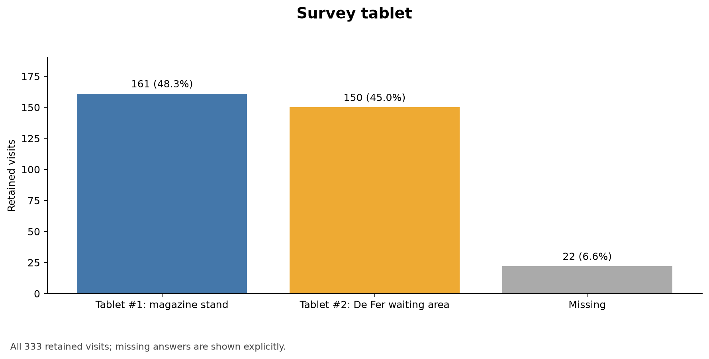
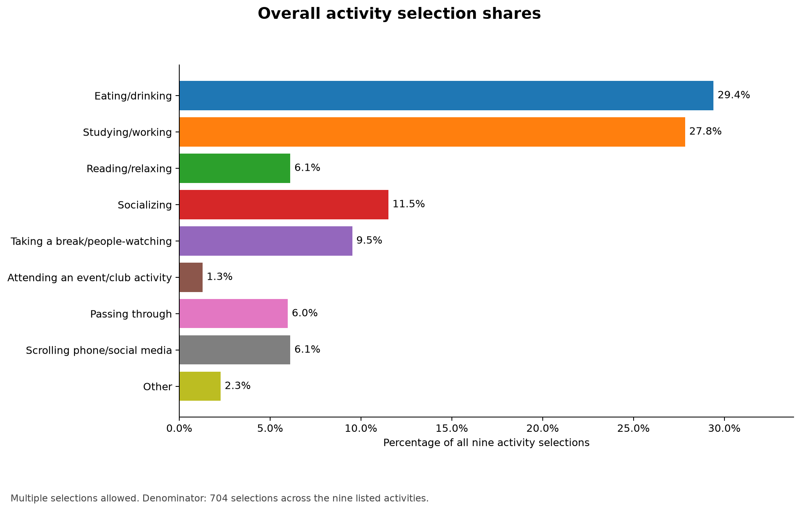
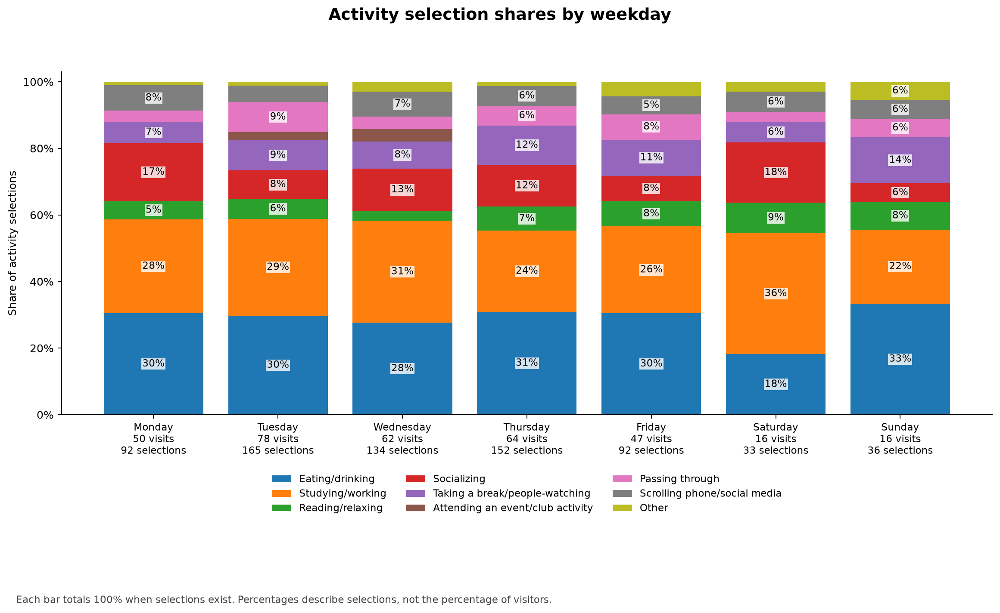
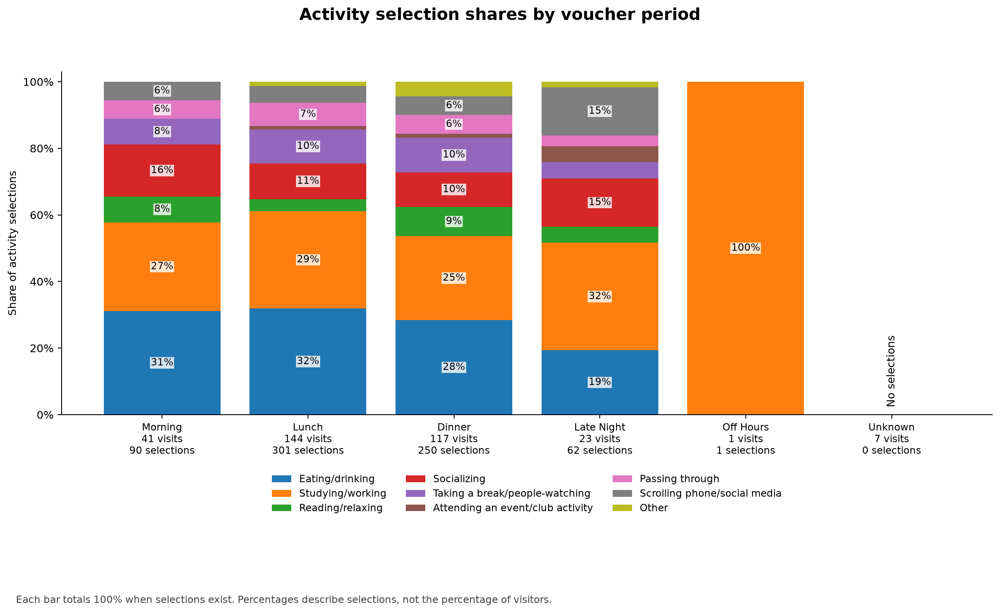
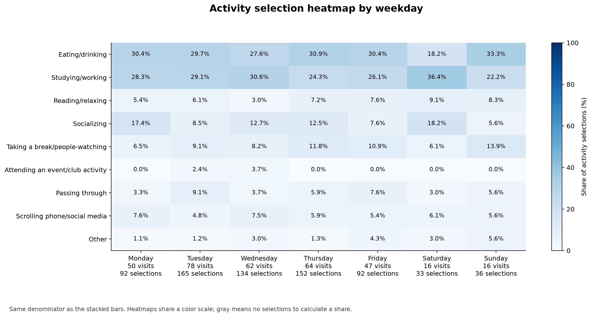
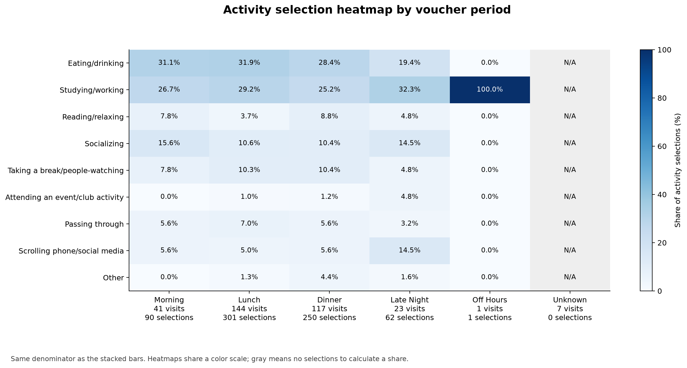
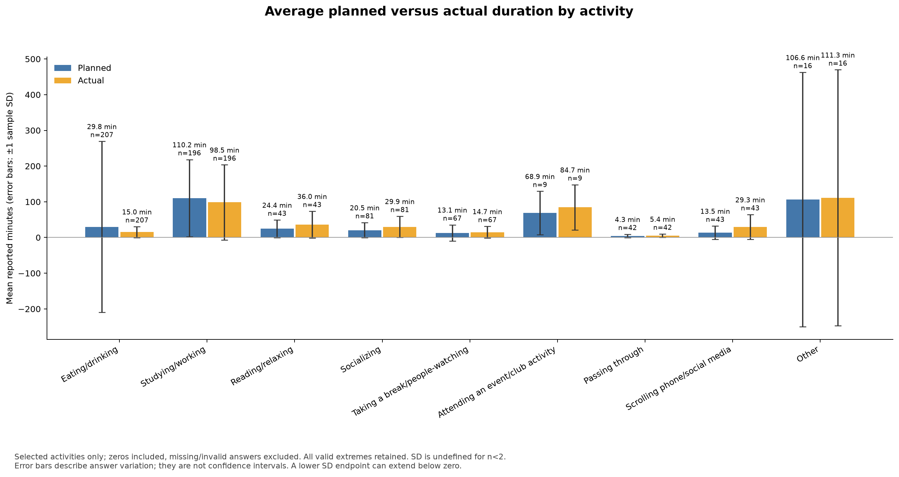
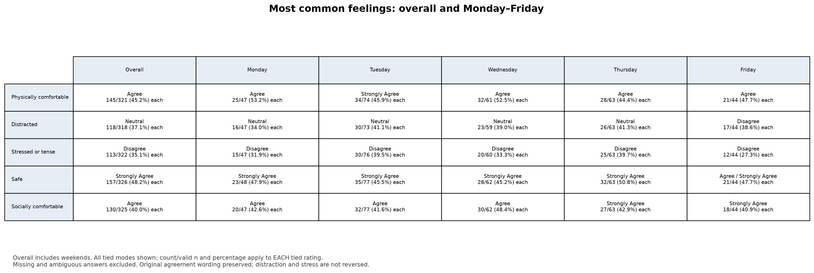
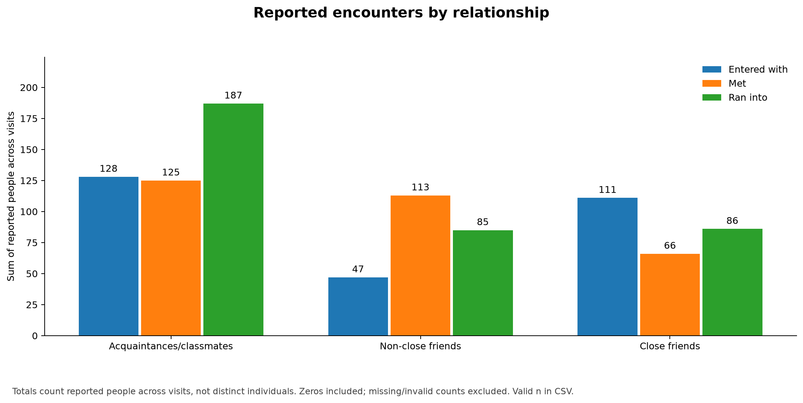
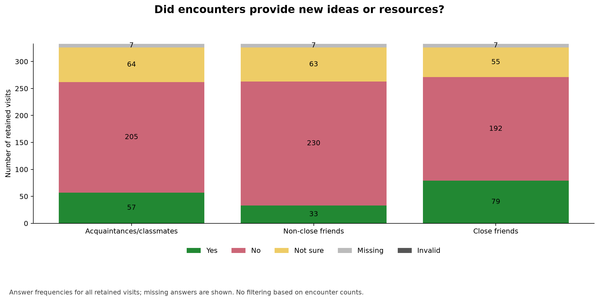

# Hunt Library survey analysis

Source: `2026-Grace-Hunt Library Survey_November 5, 2026_10.09.csv`.

Retained **333 visits**, with **238 identified participants** and 7 visits without participant identity.

See [general participation statistics](general_statistics.md) for completed-survey ID counts, the most frequent day/time, and repeat participation before same-day deduplication.

## Reading the results

The shared post-processing rules exclude staff, previews, and nonconsenting records, then keep the earliest identified participant submission per local day. Repeated visits on different days count separately. These are descriptive results without participant weighting or sampling-exposure corrections.

Exclusions: {"no_consent": 13, "same_person_same_day_later_submission": 1, "staff": 50}.

All activity percentage plots use the **share of selections across the nine listed activities**, summing to 100% within each group when selections exist. For example, a 40% Monday bar means 40% of Monday's activity selections, rather than 40% of Monday's visitors. The activity CSVs also include `percent_visits` (all retained visits in that group as denominator), which can sum above 100% for multiple-choice answers.

There are 704 selections across the nine activities and 7 missing activity answers. Legacy planned-meeting selections (4 visits) are reported here separately and excluded from the nine-activity charts and percentage denominators. Unknown activity choices occur in 0 visits and are also excluded from those denominators.

Weekdays use survey start in Eastern time. Time categories use the recorded voucher periods; no new clock boundaries are inferred. Only observed voucher categories are plotted, including Unknown. Weekday activity charts include weekends. Sentiment comparisons cover Monday–Friday; overall sentiments include weekends.

## Duration interpretation

Bars show arithmetic mean planned/actual minutes for visits selecting each activity; error bars show **±1 sample standard deviation**, not standard error or confidence intervals. Zero answers are included. Missing, negative, or nonfinite values are excluded; SD is blank for fewer than two valid answers. Planned and actual means use their respective valid answers, so their sample sizes can differ. An SD endpoint below zero describes dispersion around the mean, not a negative observed duration. All valid extreme durations are retained; the CSV includes medians, maxima, and missing/invalid counts for review.

Duration details without a selected activity: 0 visit/activity combinations; excluded from these mean comparisons.

Reported durations exceeding four hours (review examples, not an exclusion threshold):

| Activity | Timing | Maximum minutes |
| --- | --- | --- |
| Eating/drinking | Planned | 3456 |
| Studying/working | Planned | 600 |
| Studying/working | Actual | 720 |
| Other | Planned | 1440 |
| Other | Actual | 1450 |

## Most common feelings

All tied modes are reported. Percentages refer to valid single-rating answers; missing and ambiguous answers are counted separately in the CSV. Stress and distraction retain the original wording and are not reverse scored.

| Statement | Overall | Monday | Tuesday | Wednesday | Thursday | Friday |
| --- | --- | --- | --- | --- | --- | --- |
| Physically comfortable | Agree (145/321; 45.2% each) | Agree (25/47; 53.2% each) | Strongly Agree (34/74; 45.9% each) | Agree (32/61; 52.5% each) | Agree (28/63; 44.4% each) | Agree (21/44; 47.7% each) |
| Distracted | Neutral (118/318; 37.1% each) | Neutral (16/47; 34.0% each) | Neutral (30/73; 41.1% each) | Neutral (23/59; 39.0% each) | Neutral (26/63; 41.3% each) | Disagree (17/44; 38.6% each) |
| Stressed or tense | Disagree (113/322; 35.1% each) | Disagree (15/47; 31.9% each) | Disagree (30/76; 39.5% each) | Disagree (20/60; 33.3% each) | Disagree (25/63; 39.7% each) | Disagree (12/44; 27.3% each) |
| Safe | Strongly Agree (157/326; 48.2% each) | Strongly Agree (23/48; 47.9% each) | Strongly Agree (35/77; 45.5% each) | Strongly Agree (28/62; 45.2% each) | Strongly Agree (32/63; 50.8% each) | Agree / Strongly Agree (21/44; 47.7% each) |
| Socially comfortable | Agree (130/325; 40.0% each) | Agree (20/47; 42.6% each) | Agree (32/77; 41.6% each) | Agree (30/62; 48.4% each) | Strongly Agree (27/63; 42.9% each) | Strongly Agree (18/44; 40.9% each) |

## Encounter interpretation

Encounter totals sum reported people across visits and do not identify distinct individuals. Valid zero counts contribute; missing/invalid counts do not. New-ideas plots show frequencies of Yes, No, Not sure, Missing, and Invalid answers across all retained visits. CSV files include valid sample sizes and missingness.

## Figures

### Survey tablet

### Activity selection frequencies

### Overall activity selection shares

### Activity selection shares by weekday

### Activity selection shares by voucher period

### Activity selection heatmap by weekday

### Activity selection heatmap by voucher period

### Average planned versus actual duration by activity

### Most common feelings: overall and Monday–Friday

### Reported encounters by relationship

### Did encounters provide new ideas or resources?

## Aggregate tables

- [tablet.csv](tables/tablet.csv)
- [activities_overall.csv](tables/activities_overall.csv)
- [activities_by_weekday.csv](tables/activities_by_weekday.csv)
- [activities_by_period.csv](tables/activities_by_period.csv)
- [durations.csv](tables/durations.csv)
- [sentiment_modes.csv](tables/sentiment_modes.csv)
- [encounter_totals.csv](tables/encounter_totals.csv)
- [new_ideas_resources.csv](tables/new_ideas_resources.csv)

Existing spatial activity maps remain available through the separate mapping workflow. This report excludes written responses and identifying fields.
